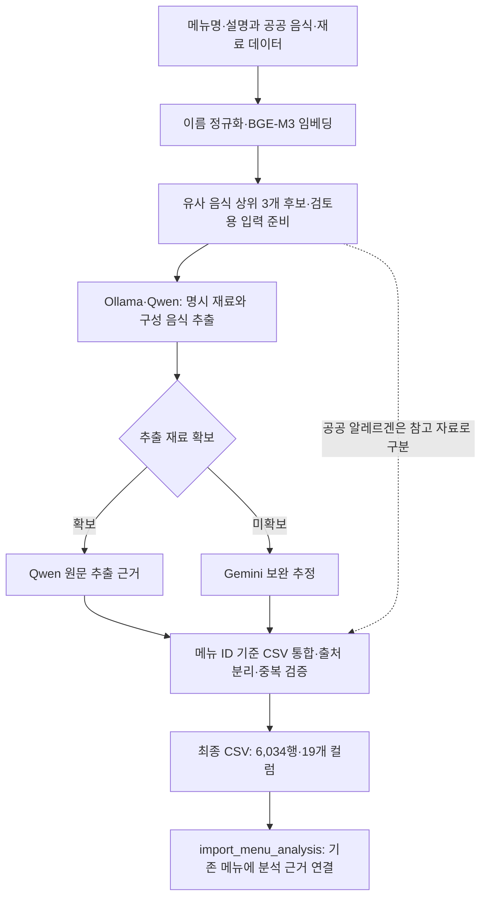

# AI 메뉴분석

[GollaEat](../../README.md) · [백엔드](../../BE/README.md) · [실행·배포 가이드](../../docs/development.md)

메뉴명·설명에서 명시 재료를 추출하고, 공공 음식 매칭과 AI 추정 결과를 출처별로 통합하는 배치 분석 영역입니다. 사용자 질문을 실시간 처리하는 AI 챗봇과 구분합니다.

## 기술 스택

| 기술 | 역할 |
| --- | --- |
| Python · CSV · JSON | 수집 결과 정리, 추출 결과 검증·통합 |
| pandas · NumPy | 테이블 정제와 유사도 계산 |
| requests · XML 파싱 | 공공 메뉴·재료 API 수집 |
| Sentence Transformers · BAAI/bge-m3 | 메뉴명과 공공 음식명의 임베딩 매칭 |
| Ollama · Qwen2.5 3B | 로컬 모델을 통한 원문 기반 재료·구성 음식 추출 |
| Gemini · google-genai | 노트북 기반 미확보 재료의 보완 추정 |
| Jupyter · python-dotenv | 단계별 실험·배치 처리와 키 로딩 |

통합 requirements 파일은 없으며 스크립트·노트북별 의존성을 별도 분석 환경에 설치합니다. 이전 실험용 OpenAI API 스크립트도 보관되어 있으나 최종 CSV의 재료 출처는 Qwen·Gemini·정보 없음으로 구분됩니다.

## 구현 파이프라인



| 단계 | 구현 방식 |
| --- | --- |
| 수집·정제 | 식당 메뉴와 공공 음식·재료 데이터를 준비하고 `preprocess_row_id` 보존 |
| 유사 음식 매칭 | 메뉴명을 정규화하고 BGE-M3 정규화 임베딩의 코사인 유사도로 상위 3개 후보 생성 |
| 명시 재료 추출 | Qwen이 원문에 있는 표현을 추출. 개별 재료와 완성 요리·세트 구성을 구분하고 JSON·원문 근거 검사 |
| 보완 추정 | 추출 재료를 확보하지 못한 메뉴에 Gemini 추정을 보완하고 명시 추출과 별도 컬럼으로 보존 |
| 결과 통합 | 메뉴 ID 기준으로 추출·추정·공공 참고 정보 결합, 중복과 상태값 검사 |
| 서비스 연동 | 기존 카탈로그 메뉴에 분석 결과를 적재하고 서버 판정의 근거로 연결 |

Qwen 전체 재개 스크립트는 중간 결과를 저장하고 기존 처리 ID가 현재 입력의 앞부분과 일치하는지 확인합니다. Gemini 추정과 최종 통합은 노트북에 구현되어 있으며 모든 단계를 한 번에 수행하는 단일 실행 명령은 제공하지 않습니다.

## 코드와 산출물

| 파일 | 담당 |
| --- | --- |
| [collect_menugen_corrected.py](collect_menugen_corrected.py) | 공공 메뉴 데이터 수집 |
| [run_bge_m3_matching.py](run_bge_m3_matching.py) | 정규화·임베딩·상위 유사 음식 후보 |
| [run_local_llm_ingredient_analysis_v5_full_resume.py](run_local_llm_ingredient_analysis_v5_full_resume.py) | Qwen 추출·검증·체크포인트·재개 |
| [gemini_api_test.ipynb](gemini_api_test.ipynb) | Gemini 보완 분석과 결과 통합 |
| [run_menu_ingredient_analysis.py](run_menu_ingredient_analysis.py) | 이전 OpenAI 기반 추출·비교 실험 |
| [menugen_backend_final.csv](menugen_backend_final.csv) | 백엔드 연동용 최종 데이터 |

### 최종 CSV 현황

아래 수치는 저장소의 `menugen_backend_final.csv` 기준이며 배포 DB의 적재 건수와는 별개입니다.

| 항목 | 건수 |
| --- | ---: |
| 전체 메뉴 | 6,034 |
| 컬럼 | 19 |
| 메뉴 ID 중복 | 0 |
| Qwen 명시 재료 추출 | 1,948 |
| Gemini 재료 추정 | 463 |
| 재료 정보 없음 | 3,623 |

## 실행과 백엔드 연결

분석 환경에서 필요한 입력 CSV를 먼저 준비합니다. 아래 명령은 `AI/menu-analysis/` 기준이며 원본·중간 파일은 별도 준비가 필요합니다.

```powershell
# 공개 음식 후보 매칭. 최초 실행 시 모델 다운로드가 필요합니다.
python run_bge_m3_matching.py --menus general_menus.csv --foods public_foods.csv --output menu_embedding_matches.csv

# Ollama에서 qwen2.5:3b가 준비된 상태로 실행합니다.
python run_local_llm_ingredient_analysis_v5_full_resume.py --matches menu_matching_classified.csv --ingredients public_ingredients_clean.csv --all
```

첫 명령의 출력과 Qwen 입력 사이에는 검토·분류 데이터 준비가 필요합니다. 최종 CSV만으로 전체 분석을 재현할 수는 없습니다. Gemini 노트북의 API 키는 분석 환경에서 관리합니다.

백엔드 `BE/`에서 기존 메뉴와 연결할 데이터를 먼저 검증합니다.

```powershell
.\.venv\Scripts\python.exe manage.py import_menu_analysis --csv ../AI/menu-analysis/menugen_backend_final.csv --dry-run
```

검증 결과와 대상 DB를 확인한 후 실제 적재 시 `--dry-run`을 생략합니다. 기본 카탈로그 적재와 AI 분석 적재는 별개입니다.

## 근거의 범위

- Qwen 추출은 메뉴 텍스트의 표현이며 실제 식당의 전체 원재료 목록을 보장하지 않습니다.
- Gemini 추정은 실제 사용 재료와 다를 수 있습니다. AI 미언급은 성분 불포함 근거가 아닙니다.
- 공공 유사 음식과 알레르겐은 자동 매칭 참고 자료이며 실제 매장 메뉴의 확정 성분으로 취급하지 않습니다.
- 전체 메뉴의 `allergy_safety_status`는 `UNKNOWN_NOT_VERIFIED`입니다. 식당의 재료와 교차접촉 가능성은 별도로 확인해야 합니다.

## 출력 스키마

| 컬럼명 | 설명 |
|---|---|
| `preprocess_row_id` | 메뉴별 고유 ID |
| `place_id` | 식당 식별 정보 |
| `restaurant_name` | 식당명 |
| `menu_name` | 메뉴명 |
| `description` | 메뉴 설명 |
| `explicit_ingredients` | Qwen이 메뉴 텍스트에서 추출한 재료 |
| `explicit_components` | 메뉴 텍스트에서 확인된 구성 음식 |
| `gemini_estimated_ingredients` | Gemini가 추정한 재료 |
| `ingredient_source` | 재료 정보 출처 |
| `evidence_level` | 텍스트 근거 수준 |
| `information_status` | 재료 정보 상태 |
| `gemini_status` | Gemini 분석 처리 상태 |
| `top1_fd_Code` | 공공데이터 유사 음식 후보 코드 |
| `public_reference_food_name` | 유사 음식명 |
| `public_reference_allergens` | 유사 음식의 정규화된 참고 알레르겐 |
| `public_reference_allergy_raw` | 유사 음식의 원본 알레르기 정보 |
| `public_reference_status` | 공공데이터 참고 정보의 검증 상태 |
| `restaurant_ingredient_verification` | 실제 식당 재료 검증 여부 |
| `allergy_safety_status` | 알레르기 안전성 검증 상태 |
