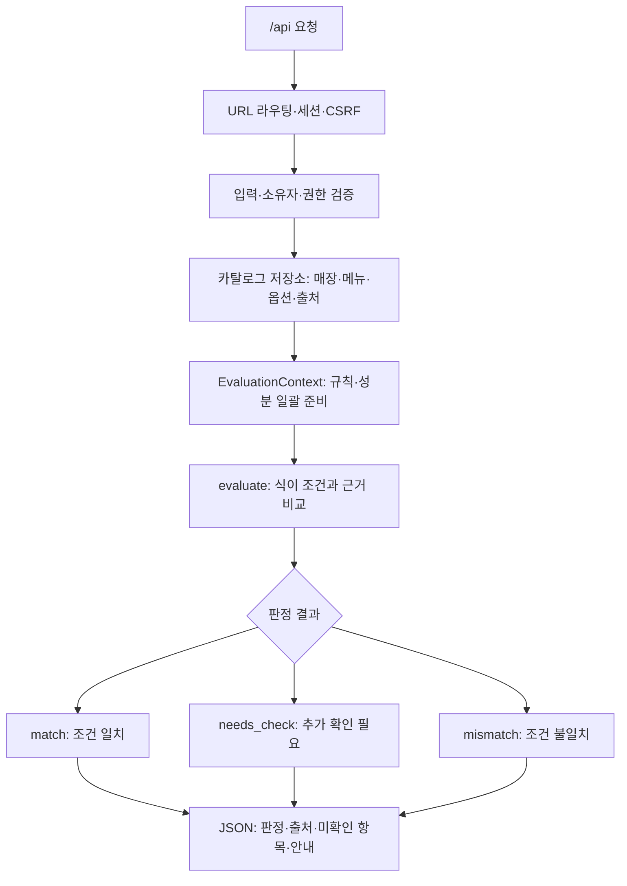

# 백엔드

[GollaEat](../README.md) · [실행·배포 가이드](../docs/development.md)

식당·메뉴 카탈로그, 사용자 식이 프로필, 메뉴 판정, 사용자 활동과 관리자 API를 제공합니다. AI 챗봇도 같은 Django 프로젝트에서 카탈로그·판정 로직을 재사용합니다.

## 기술 스택

| 기술 | 역할 |
| --- | --- |
| Python 3.12 · Django 5.2 | URL 라우팅, JSON API, 세션, CSRF, ORM, 관리자 |
| SQLite | `DATABASE_URL`이 없을 때 로컬 기본 DB |
| PostgreSQL · Supabase | 배포 DB와 카탈로그·프로필 저장 |
| psycopg · dj-database-url | PostgreSQL 드라이버, 연결 풀 및 DB URL 설정 |
| python-dotenv | `BE/.env` 로딩. 기존 프로세스 환경변수 우선 |
| Gunicorn · WhiteNoise | WSGI 애플리케이션 실행과 정적 파일 제공 |
| Docker · Railway | 이미지 빌드와 배포 전 마이그레이션 |
| Django TestCase | API 계약·판정·DB·회귀 테스트 |

의존성은 [requirements.txt](requirements.txt)에 고정되어 있습니다. API는 Django의 뷰와 `JsonResponse`를 사용합니다.

## 구현 파이프라인



| 단계 | 구현 |
| --- | --- |
| 요청 수신 | `config/urls.py`에서 카탈로그·식이·챗봇·관리 API로 분기 |
| 검증 | 세션 기반 프로필 소유자 식별, 요청 형식·식별자·CSRF·권한 검사 |
| 조회 | 카탈로그 저장소에서 매장·메뉴·옵션·성분·출처 조회 |
| 판정 | `EvaluationContext`가 조건·규칙·성분 조회를 재사용하고 `evaluate()`가 조건별 결과 계산 |
| 응답 | 판정 상태, 문제 성분, 미확인 항목, 출처와 사용자 안내를 JSON으로 반환 |

### 식이 판정

- 제한 성분의 확인된 포함 근거 또는 Qwen 추출·Gemini 추정 근거가 있으면 `mismatch`로 분류합니다. AI 근거는 실제 포함 확인과 구분합니다.
- 규칙·출처·불포함 확인이 부족하면 `needs_check`로 유지합니다. AI 미언급은 불포함 근거가 아닙니다.
- 조건별 결과는 `mismatch` → `needs_check` → `match` 우선순위로 합산합니다. 조건 미설정 시 `match`는 성분 안전성 확인을 뜻하지 않습니다.
- 요청 단위 일괄 조회, 프로세스 메모리 판정 캐시와 DB 파생 검색 인덱스로 반복 조회를 줄입니다. 인덱스는 설정과 DB 상태에 따라 사용합니다.

### 데이터와 관리

카탈로그 기본값은 `CATALOG_USE_DB=true`입니다. CSV는 적재 명령에서 읽으며 빈 DB는 빈 목록을 반환합니다. 세션 프로필에 식이 기준을 연결하고, 저장 메뉴·리뷰·제보는 사용자 소유권을 검사합니다. 관리 API는 Django 직원 계정과 모델별 권한을 사용하며, 제보 처리 이력을 기록합니다.

## 모듈 구조

| 경로 | 담당 |
| --- | --- |
| [config/](config/) | 설정·전체 URL·상태 확인·관리 API |
| [catalog/](catalog/) | 매장·메뉴 모델, 검색·지도 조회, 적재·분석 근거 어댑터 |
| [dietary/](dietary/) | 프로필·기준·규칙·판정·주문 구성 검증·사용자 활동 |
| [chatbot/](chatbot/) | 자연어 검색과 메뉴 설명 |

## 실행과 데이터 준비

[실행·배포 가이드](../docs/development.md)의 백엔드 설치·마이그레이션 후 서버를 실행합니다. 아래 명령은 `BE/`에서 실행합니다.

```powershell
# 대상 DB와 입력 파일을 먼저 확인한 뒤 실제 카탈로그를 적재합니다.
.\.venv\Scripts\python.exe manage.py import_catalog --csv C:/data/final.csv --coordinates C:/data/coordinates.csv

# 이미 존재하는 메뉴에 AI 분석 데이터를 연결하기 전 검증합니다.
.\.venv\Scripts\python.exe manage.py import_menu_analysis --csv ../AI/menu-analysis/menugen_backend_final.csv --dry-run
```

카탈로그 CSV 경로는 예시입니다. 좌표 파일은 선택 사항이며, AI 분석 CSV만으로 기본 매장·메뉴가 생성되지는 않습니다. 마이그레이션과 데이터 적재는 별개입니다.

## 검증과 상세 문서

`BE/`에서 실행하며 운영 DB 대신 SQLite 또는 별도 테스트 DB를 사용합니다.

```powershell
.\.venv\Scripts\python.exe manage.py check
.\.venv\Scripts\python.exe manage.py test
```

[카탈로그 적재](catalog/README.md) · [카탈로그 API](catalog/API.md) · [식이 판정 계약](dietary/README.md) · [AI 챗봇](chatbot/README.md)
