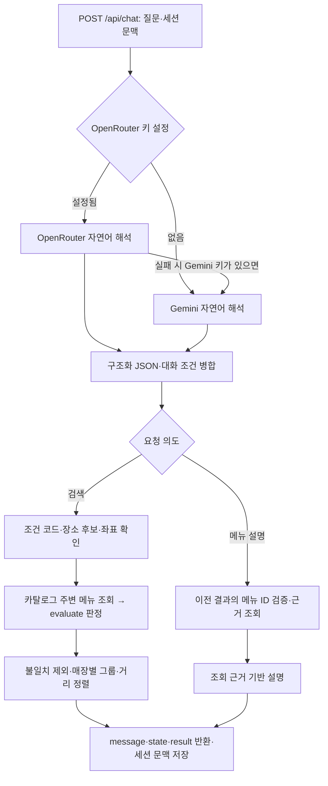

# AI 챗봇

[GollaEat](../../README.md) · [백엔드](../README.md) · [실행·배포 가이드](../../docs/development.md)

자연어 질문에서 장소·메뉴·식이 조건을 추출하고, 실제 카탈로그 검색과 서버 식이 판정을 연결합니다. LLM은 질문 해석과 설명을 보조하고, 메뉴의 판정 상태는 Django의 `evaluate()`가 결정합니다.

## 기술 스택

| 기술 | 역할 |
| --- | --- |
| Python · Django | `/api/chat` 뷰, 세션·프로필·카탈로그 연동 |
| OpenRouter | 키가 설정되면 우선 사용하는 무료 모델 제공자 |
| Gemini API | OpenRouter 실패 시 대체 호출 또는 단독 자연어 처리 |
| JSON 스키마 · urllib | 구조화된 모델 응답과 HTTP 요청·오류 처리 |
| Kakao Local REST API | 장소명 검색과 좌표 후보 반환 |
| Django ORM · 식이 판정 엔진 | 주변 매장·메뉴 조회, 기준 코드 연결, 근거 평가 |

별도 LLM Python SDK 없이 표준 라이브러리로 모델 제공자를 호출합니다. 모델 이름과 키는 환경변수로 설정합니다.

## 구현 파이프라인



1. 세션의 프로필, 최근 대화와 이전 메뉴 결과를 읽습니다. 웹 API는 요청마다 저장된 프로필 기준을 대화 상태에 반영합니다.
2. LLM이 `intent`, `place`, `menu`, `restaurant`, `allergens`, `ingredients` 등의 JSON 변경값을 반환합니다. 모호한 의도는 확인 질문으로 처리합니다.
3. 조건명을 DB의 활성 기준 코드로 바꾸고, 장소를 좌표로 해석합니다. 장소 후보가 여러 개면 사용자가 선택하도록 반환합니다.
4. 카탈로그에서 반경 내 메뉴를 찾고 `EvaluationContext`와 `evaluate()`로 판정합니다. 불일치는 제외하며 일치·추가 확인 목록을 매장별로 묶어 거리순으로 정렬합니다.
5. 응답을 구성하고 상태·최근 대화 6개·검색 결과 문맥을 세션에 보관합니다. 특정 메뉴 설명은 별도 설명 경로로 분기하며, 조회된 근거를 바탕으로 문장을 생성합니다.

### 대화 처리 규칙

| 상황 | 처리 |
| --- | --- |
| “우동으로 바꿔줘” | 명시된 메뉴 조건을 변경하고 나머지 문맥 유지 |
| 추가 식이 제한 | 대화 상태에 반영. 저장 프로필 수정 API는 호출하지 않음 |
| 조건 해제·모호한 유형 | 확인 질문 반환 |
| 이전 메뉴의 이유 질문 | 직전 검색 결과에 있는 메뉴 ID인지 검사 |
| 반경 확대 | 위치 확인 후 1km 단위로 최대 5km까지 확대 |
| 모델 호출 실패 | 가능한 경우 제공자 전환. 처리 불가 시 503과 재시도 안내 |

## 설정과 실행

백엔드 설치·데이터 적재 후 `BE/.env` 또는 서버 환경변수에 설정합니다.

| 환경변수 | 의미 |
| --- | --- |
| `OPENROUTER_API_KEY` | 설정 시 우선 제공자로 사용 |
| `OPENROUTER_MODEL` | 기본 `openrouter/free`. 다른 모델은 `:free`만 허용 |
| `GEMINI_API_KEY` | Gemini 단독 호출 또는 대체 호출용 키 |
| `GEMINI_MODEL` | 코드 기본값 `gemini-3.5-flash-lite` |
| `KAKAO_LOCAL_REST_API_KEY` | 장소명 검색 키. FE 지도 JavaScript 키와 별개 |

OpenRouter와 Gemini 중 사용할 제공자의 키가 필요합니다. OpenRouter만 설정하면 실패 시 Gemini로 전환할 수 없습니다. 실제 모델 제공 여부·한도는 계정 및 제공자 상태에 따라 달라집니다.

### 웹 API

`GET /api/session`에서 `csrf_token`을 받고 같은 세션 쿠키를 유지해 `POST /api/chat`을 호출합니다. JSON 요청에 `Content-Type: application/json`, `X-CSRFToken` 헤더를 전달합니다.

```json
{"message":"순천향대 근처에서 우유 알레르기가 있는 내가 먹을 김밥 찾아줘"}
```

| 요청 | 용도 |
| --- | --- |
| `{"new_conversation": true}` | 대화 초기화 |
| `{"location": {"lat": 36.7698, "lng": 126.9316}}` | 선택한 검색 위치 전달 |
| `{"radius_m": 2000}` | 현재 검색 반경 확대 |

응답은 `message`(사용자 안내), `state`(대화 조건), `result`(메뉴 목록·장소 후보·확인 질문)로 구성됩니다.

### CLI

저장소 루트에서 실행합니다. 프로필 UUID는 기존 세션의 프로필 ID를 사용합니다. CLI의 `--gemini` 검사는 Django 설정 로딩보다 먼저 실행되므로 `GEMINI_API_KEY`를 현재 터미널의 프로세스 환경변수에도 설정해야 합니다. 웹 API와 달리 이 옵션은 OpenRouter만 설정한 상태로 시작할 수 없습니다.

```powershell
Push-Location BE
.\.venv\Scripts\python.exe -m chatbot.chatbot --backend --profile-id <프로필UUID> --gemini
Pop-Location
```

`--gemini`를 생략하면 제한된 데모 해석기를, `--backend`를 생략하면 예시 검색을 사용합니다. 실제 주변 검색은 위치 정보와 적재된 카탈로그가 필요합니다.

## 코드와 검증

| 파일 | 담당 |
| --- | --- |
| [views.py](views.py) | 세션·요청 검증, 제공자 호출, 반경·이력·응답 관리 |
| [chatbot.py](chatbot.py) | 프롬프트, 제공자 전환, JSON 해석, 상태 병합, CLI |
| [backend.py](backend.py) | 기준 코드 변환, 실제 판정, 매장별 결과 그룹 |
| [catalog_search.py](catalog_search.py) | 위치·반경 검증과 DB/CSV 카탈로그 검색 |
| [places.py](places.py) · [explanation.py](explanation.py) | 장소 후보와 메뉴 설명 |

`BE/`에서 실행합니다.

```powershell
.\.venv\Scripts\python.exe manage.py test chatbot.test_backend chatbot.test_views chatbot.test_provider
```
