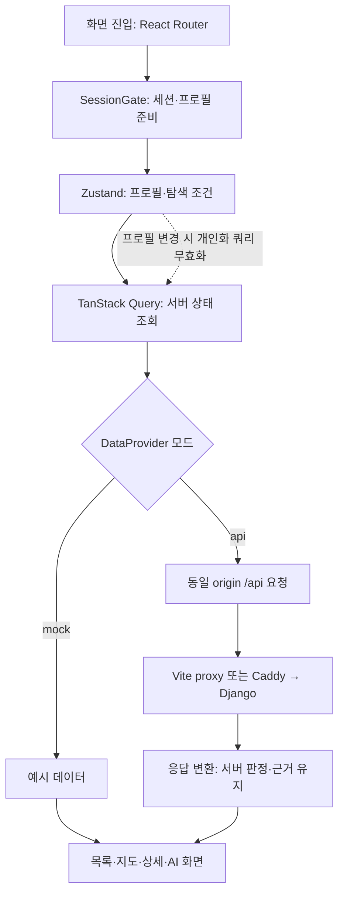

# 프론트엔드

[GollaEat](../README.md) · [실행·배포 가이드](../docs/development.md)

식이 프로필 설정부터 목록·지도 탐색, 메뉴 확인, AI 대화까지 제공하는 모바일 웹입니다. 관리자 화면도 같은 React 앱에서 별도 경로로 제공합니다.

## 기술 스택

| 기술 | 역할 |
| --- | --- |
| React 19 · TypeScript | 컴포넌트와 화면·API 타입 정의 |
| Vite 7 | 개발 서버, API 프록시, 프로덕션 빌드 |
| React Router 7 | 페이지 라우팅과 화면별 지연 로딩 |
| Tailwind CSS 4 · Lucide React | 스타일·디자인 토큰과 아이콘 |
| TanStack Query 5 | 서버 데이터 조회·캐시·무효화 |
| Zustand 5 | 식이 프로필, 탐색 필터 등 클라이언트 상태 |
| Kakao Maps JavaScript SDK | 지도, 식당 마커, 영역 기반 탐색 |
| Vitest · Testing Library · ESLint | 화면·로직 테스트와 정적 검사 |

세부 의존성 버전은 [package.json](package.json)을 기준으로 합니다.

## 구현 파이프라인



1. `SessionGate`가 API 세션과 프로필을 준비하고 `PhoneFrame`이 모바일 화면 틀을 제공합니다.
2. 페이지와 훅이 필터·위치·프로필을 조회 조건으로 구성합니다. TanStack Query는 서버 상태를, Zustand는 프로필·탐색 UI 상태를 관리합니다.
3. `DataProvider`가 `api` 또는 `mock` 구현을 선택합니다. API 모드는 같은 origin의 `/api/*`를 호출하고 어댑터가 응답을 UI 모델로 변환합니다.
4. 프로필 변경 시 개인화 쿼리를 무효화하고, 세션 식별자가 바뀌면 기존 캐시를 비워 이전 사용자의 결과가 남지 않게 합니다.

### 핵심 화면의 구현

| 영역 | 구현 방식 |
| --- | --- |
| 목록·지도 | 서버 검색·필터·페이지 처리, 지도 bounds 변경 후 지연 조회, 식당별 메뉴 바텀시트 |
| 메뉴 상세·판단 근거 | 서버 `judgement`의 상태·출처·안내를 표시. `needs_check`는 UI의 `check` 상태에 대응 |
| 직원 안내·문의 | 프로필과 선택 메뉴에 맞춘 확인 문구 표시 |
| AI 탐색 | 질문·장소 선택·반경 확대 요청을 챗봇 API와 연결 |
| 관리자 | `/manage/*`에서 직원 로그인과 모델별 권한을 사용하는 관리 API 호출 |

실제 API 모드의 판정은 서버 응답을 사용합니다. 브라우저는 `analysis_reference` 원자료로 판정을 생성하지 않습니다.

## 코드 구조

| 경로 | 담당 |
| --- | --- |
| [src/AppRouter.tsx](src/AppRouter.tsx) | 라우팅, 페이지 지연 로딩, 사용자·관리자 경계 |
| [src/pages/](src/pages/) | 온보딩, 탐색, 지도, 상세, 마이, AI 화면 |
| [src/components/](src/components/) | 세션·로딩·화면 틀과 공통 UI |
| [src/hooks/](src/hooks/) | 위치, 탐색, 저장과 바텀시트 동작 |
| [src/lib/api/](src/lib/api/) | API 클라이언트, 제공자, 타입, 응답 변환, 쿼리 키 |
| [src/store/](src/store/) | 프로필·저장 메뉴·리뷰 상태 |
| [src/admin/](src/admin/) | 관리자 UI와 API |

## 로컬 실행

Node.js 22 기준이며 저장소 루트에서 시작합니다.

```powershell
cd FE
npm ci
Copy-Item .env.example .env.local
npm run dev
```

`.env.local`이 있으면 복사를 생략합니다. 접속 주소는 [localhost:5173](http://localhost:5173)입니다.

| 환경변수 | 의미 |
| --- | --- |
| `VITE_DATA_MODE` | `api` 기본값, `mock`은 UI 확인용 예시 데이터 |
| `VITE_API_PROXY_TARGET` | 로컬 API 프록시 대상. 기본 `http://127.0.0.1:8000` |
| `VITE_KAKAO_MAP_APP_KEY` | 카카오맵 JavaScript 키. 사용할 도메인 등록 필요 |
| `BACKEND_ORIGIN` | 배포 Caddy의 백엔드 주소. 브라우저 빌드 설정과 구분 |

지도 키는 빌드 시 주입됩니다. DB 접속 정보와 서버 AI 키는 FE 환경변수에 넣지 않습니다.

## 검증과 상세 문서

```powershell
npm test
npm run build
npm run lint
```

[지도·탐색 구현](docs/map-discovery.md) · [API 계약](docs/api-spec.md) · [배포 설정](../docs/development.md)
