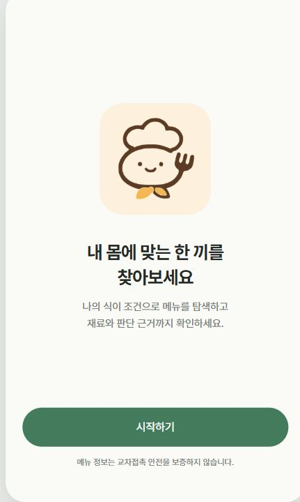
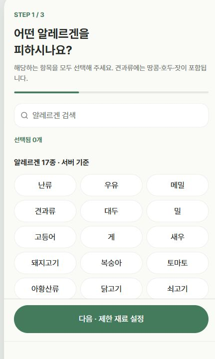
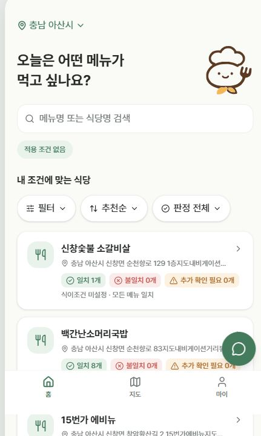
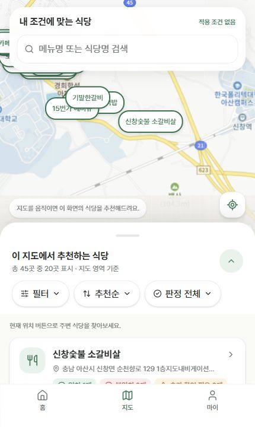
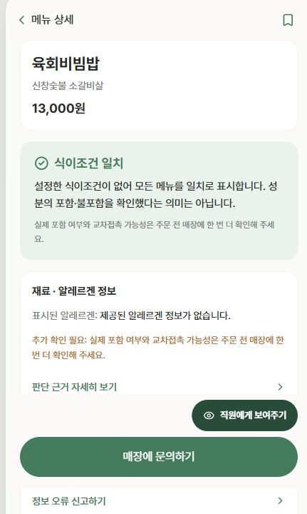
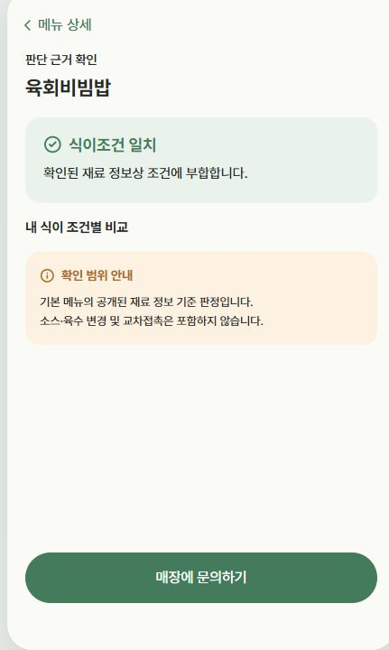
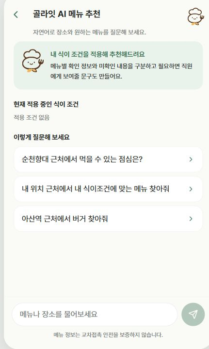
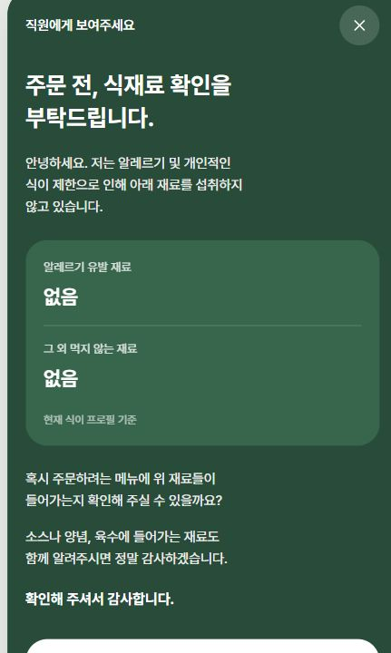
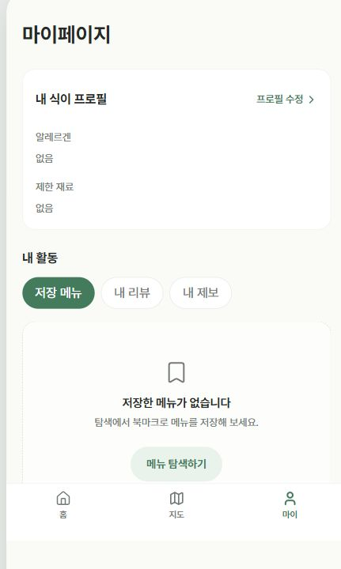

  

<h1 align="center">GollaEat</h1>

  <strong>내 식이 조건에 맞는 한 끼를 고르는 골라잇</strong> 
  알레르기·채식·개인 식이 제한을 바탕으로 메뉴를 탐색하고, 
  재료 정보와 판단 근거를 확인해 주문 전 선택을 돕는 모바일 웹 서비스입니다.

  <a href="#서비스-소개">서비스 소개</a> ·
  <a href="#주요-기능">주요 기능</a> ·
  <a href="#페이지별-화면">페이지별 화면</a> ·
  <a href="#팀원">팀원</a>

## 서비스 소개

**“이 메뉴, 내 식이 조건에 맞을까?”**

골라잇은 알레르기·채식·개인 식이 제한이 있는 사람의 메뉴 선택을 돕습니다. 내 조건을 설정하고, 주변 식당의 메뉴와 재료 정보를 비교한 뒤 주문 전 확인할 내용을 살펴보세요.

## 주요 기능

| 내 조건을 설정하고 | 먹고 싶은 메뉴를 찾고 | 근거를 확인해 주문까지 |
| :--- | :--- | :--- |
| 알레르겐·제한 재료 설정 | 주변 식당을 목록·지도에서 탐색 | 메뉴별 판정과 판단 근거 확인 |
| 마이페이지에서 프로필·저장 메뉴 관리 | AI에게 자연어로 메뉴 질문 | 매장 문의·직원 안내·정보 제보 |

## 페이지별 화면

**식이 조건 설정 → 목록·지도 탐색 → 메뉴와 근거 확인 → 매장 확인**

<table>
  <tr>
    <th width="33%">시작</th>
    <th width="33%">식이 조건 설정</th>
    <th width="33%">식당·메뉴 탐색</th>
  </tr>
  <tr>
    <td></td>
    <td></td>
    <td></td>
  </tr>
  <tr>
    <th width="33%">지도 탐색</th>
    <th width="33%">메뉴 상세</th>
    <th width="33%">판단 근거</th>
  </tr>
  <tr>
    <td></td>
    <td></td>
    <td></td>
  </tr>
  <tr>
    <th width="33%">AI 메뉴 탐색</th>
    <th width="33%">직원에게 보여주기</th>
    <th width="33%">마이페이지</th>
  </tr>
  <tr>
    <td></td>
    <td></td>
    <td></td>
  </tr>
</table>

화면의 목록과 판정은 식이 프로필·위치·등록 데이터에 따라 달라집니다. 위 메뉴 예시는 식이 조건 미설정 상태입니다.

## 메뉴 판정 안내

| 조건 일치 | 추가 확인 필요 | 조건 불일치 |
| :--- | :--- | :--- |
| 제공된 정보 기준으로 내 조건에 부합 | 정보가 부족해 매장 확인 필요 | 제한 성분의 포함 근거 또는 AI 추출·추정에 따라 제외 |

> 판정은 섭취 안전성을 보장하지 않습니다. 공식 정보와 AI 추정은 구분하며, 식이 조건 미설정 상태의 일치는 성분 확인을 뜻하지 않습니다. 실제 재료와 교차접촉 가능성은 주문 전 매장에 확인해 주세요.

## 개발 문서

| 문서 | 내용 |
| --- | --- |
| [실행·배포 가이드](docs/development.md) | 개발 환경 · 서비스 배포 파이프라인 |
| [프론트엔드](FE/README.md) | 화면 구성 · 상태 관리 · API 연동 |
| [백엔드](BE/README.md) | 카탈로그 · 식이 판정 · 데이터 흐름 |
| [AI 챗봇](BE/chatbot/README.md) | 자연어 해석 · 주변 검색 · 판정 연결 |
| [AI 메뉴분석](AI/menu-analysis/README.md) | 재료 추출 · 보완 추정 · 데이터 통합 |

## 팀원

| 항목 | 팀원 1 | 팀원 2 | 팀원 3 | 팀원 4 | 팀원 5 |
| :--- | :---: | :---: | :---: | :---: | :---: |
| 이름 | Seon-K | hyejung87 | kyeoon | jangchaeun660 | kimyu11 |
| 깃허브 프로필 | [Seon-K](https://github.com/Seon-K) | [hyejung87](https://github.com/hyejung87) | [kyeoon](https://github.com/kyeoon) | [jangchaeun660](https://github.com/jangchaeun660) | [kimyu11](https://github.com/kimyu11) |
| 역할 | 팀장, 백엔드 | 백엔드 | AI 챗봇 | AI 메뉴분석 | 프론트엔드 |
